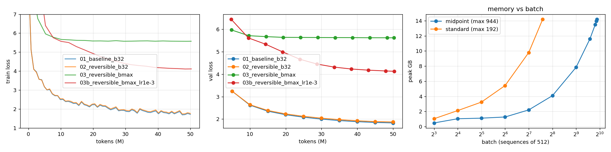

# Reversible training of a 20M-parameter GPT on 50M tokens

A 21M-parameter GPT is trained on 50M TinyStories tokens on a single **Colab T4** four ways:

1. ordinary backprop at a fixed batch
2. **reversible** backprop (no stored activations) at the same batch
3. reversible at the **largest batch that fits**
4. an LR ablation of run 3

All numbers below come from the executed notebooks in this repo.



## Results

| Run | Stack | Batch (seq × 512) | Tokens / step | Steps | Peak LR | Final train loss | Final val loss | Tokens / s | Peak mem (GB) | Train time |
|---|---|---|---|---|---|---|---|---|---|---|
| **1 · baseline** | standard | 32 | 16,384 | 3,052 | 1e-3 | **1.770** | **1.830** | **76.9k** | 3.24 | 10.8 min |
| **2 · reversible** | midpoint | 32 | 16,384 | 3,052 | 1e-3 | **1.813** | **1.871** | **60.5k** | **1.11** | 13.8 min |
| **3 · reversible, max batch** | midpoint | **944** | 483,328 | 104 | 3e-3 (√-scaled) | 5.581 | 5.616 | 53.4k | 14.18 | 15.7 min |
| 3b · max batch, LR ablation | midpoint | 936 | 479,232 | 105 | 1e-3 | 4.243 | 4.127 | 51.2k | 14.06 | 16.3 min |

Hardware: Tesla T4 (15 GB), fp16 autocast + GradScaler, PyTorch 2.11, eager mode.
Peak memory = `torch.cuda.max_memory_allocated`; reserved memory is 3.47 / 1.30 / 14.39 / 14.42 GB.
Final train loss = mean of the last 50 steps; final val loss = 500k held-out tokens.
Full table: [`results/summary.md`](results/summary.md).

**Largest batch that fits (probe of a full forward + backward + AdamW step):**

| Stack | Max batch | Tokens / step | Memory per extra sequence |
|---|---|---|---|
| standard | 192 | 98,304 | 73.1 MB |
| reversible (midpoint) | **944** | **483,328** | **15.0 MB** |

Reversibility buys **4.9× larger batches** on the same GPU.

### Key findings

1. **Midpoint (leapfrog) is the reversible variant that worked best.**

   | Variant | Gradient check (rel. error vs autograd, fp64) | 5M-token val loss | Tokens / s |
   |---|---|---|---|
   | standard (reference) | — | 3.533 | 76.3k |
   | **midpoint** (leapfrog) | **1.7e-15** (exact) | **3.617** | 60.7k |
   | revnet (coupling / symplectic Euler) | 3.1e-15 (exact) | 3.908 | 61.5k |
   | euler, fixed-point inverse (4 it) | 0.96 (wrong) | 5.982 (fails) | 33.8k |
   | euler, emb std 0.5 (4 it) | 5.7e-5 (on the grad-check model) | 5.981 (fails) | 34.2k |

   - Midpoint and RevNet are both algebraically exact, and their gradients match plain autograd to machine precision.
   - Midpoint wins because it keeps the baseline's block (`F = Attn + MLP`, one residual update per layer). Its loss curve lies almost on top of the baseline's.
   - RevNet splits each block into two half-steps on two streams, which changes the function and trained noticeably slower in the bake-off.
   - Euler does not train. Its fixed-point inverse needs Lip(F) < 1, but pre-LN divides by the residual-stream RMS, so at the standard init (emb std 0.02) F is far from a contraction. Its gradients are ~96% wrong and more iterations make it worse.
   - A larger residual stream (emb std 0.5) makes Euler converge on the small grad-check model (errors 2e-2 → 6e-5 → 4e-8 at 1/4/8 iterations). In training the fixed-point residual still did not converge (0.07 at the end of the bake-off), so the run failed anyway. It is also ~2.2× slower, because every fixed-point iteration is one more block forward.

2. **Reversible at the same batch: memory drops 2.9×, loss almost unchanged, speed drops ~21%.**
   - Peak memory: 3.24 → 1.11 GB. Activation memory (peak minus params and Adam state): 2.99 → 0.86 GB.
   - Final val loss: 1.871 vs 1.830 (+0.04), over the same 50M tokens and the same 3,052 steps.
   - Throughput is 60.5k vs 76.9k tok/s (79% of baseline). That fits the extra forward pass in backward (theory: 3/4 = 75%, before other overheads).

3. **Max batch: the memory win is real, but 50M tokens is too few steps to use it.**
   - At 944 × 512 = 483k tokens per step, 50M tokens is only **104 optimizer steps**.
   - With the √-scaled LR (3e-3), run 3 collapsed to the unigram plateau (val ≈ 5.6, gradient norm → 0.05) and never left it.
   - Ablation 3b keeps the batch and uses LR 1e-3. It escapes the plateau and reaches val **4.13** (from 5.62), still falling at the end.
   - So both causes matter: the scaled LR was too high for so few steps, and 105 steps is far from enough either way (the baseline was at ~3.5 after 300 steps).
   - Tokens/s at max batch (53k) is *lower* than at batch 32 (60k). The T4 is already saturated at batch 32, so a bigger batch buys no throughput here.
   - The benefit of the extra headroom is fitting bigger models, longer contexts or larger batches in a longer run, not faster training at this budget.

4. **Why stored activations shrink 40–80× but max batch only 4.9×.**
   - The tensors kept between forward and backward shrink 40–80× (CPU measurement: [`results/cpu_checks.txt`](results/cpu_checks.txt)).
   - The GPU peak also includes one block's activations during its recomputation, the 8,192-token CE chunk, fp16 casts and allocator slack. These do not shrink with reversibility.
   - The measured per-sequence cost is 73.1 → 15.0 MB.

5. **Reproducible.** The whole pipeline ran twice on different T4 sessions with the same seeds:

   | Run | First session (val / tok/s) | Second session (val / tok/s) |
   |---|---|---|
   | baseline | 1.828 / 73.8k | 1.830 / 76.9k |
   | reversible | 1.876 / 57.9k | 1.871 / 60.5k |
   | max batch | 5.620 / 54.3k | 5.616 / 53.4k |

   The max batch (944 vs 192) and every memory figure were identical.

6. **Practical gotcha:** training at *exactly* the probed max batch (944) once ran out of memory at step 100/104, from allocator fragmentation. Run 3 survived at 944. The ablation uses 936 (one 8-sequence step below) and both max-batch notebooks retry at B − 8 on OOM.

---

## Notebooks

| Notebook | What it does |
|---|---|
| [`01_baseline.ipynb`](01_baseline.ipynb) | Standard transformer, ordinary backprop, **fixed batch 32 × 512**. Also probes the baseline's max batch |
| [`02_reversible.ipynb`](02_reversible.ipynb) | Gradient checks of all variants, 5M-token bake-off (Euler / midpoint / RevNet), then a 50M-token run of the winner at **batch 32** |
| [`03_reversible_maxbatch.ipynb`](03_reversible_maxbatch.ipynb) | Probes the reversible model's max batch and trains at it (**944**) |
| [`03b_maxbatch_lr_ablation.ipynb`](03b_maxbatch_lr_ablation.ipynb) | Same max-batch run with the unscaled LR 1e-3 |
| [`04_report.ipynb`](04_report.ipynb) | Collects `results/*.json` into the table, figure and `summary.md` |

All code lives in [`revllm.py`](revllm.py): data and tokenizer, model, reversible autograd, trainer and memory probe. Each notebook embeds it with `%%writefile`, so each one runs on Colab by itself.

Notebooks 01–03b were executed on a Colab T4, headless via `jupyter nbconvert --execute` ([`tools/run_all.sh`](tools/run_all.sh)). Notebook 04 only aggregates the JSON results and was executed on CPU.

## Setup

| | |
|---|---|
| Model | GPT, pre-LayerNorm, d_model 384, 10 layers, 6 heads, MLP 4×, GELU, learned positions, tied LM head, no bias, no dropout. **21.05M params** (17.7M non-embedding), identical in every mode |
| Tokenizer | byte-level BPE, vocab 8,192, trained on 100k TinyStories stories |
| Data | `roneneldan/TinyStories`: 51M tokens tokenized, **50M trained on**, each token seen once (shuffled non-overlapping 513-token windows). 1M validation tokens |
| Context | 512 |
| Optimizer | AdamW β = (0.9, 0.95), weight decay 0.1 on matrices, grad clip 1.0 |
| LR | 5% linear warmup (min 10 steps), cosine decay to 10% |
| Precision | fp16 autocast + GradScaler on T4 (bf16 is used automatically on Ampere+). The residual stream stays fp32 |
| Loss | LM head + cross-entropy in 8,192-token chunks with recomputation, so `B·T·V` logits are never materialised. Used in **all** runs, so the memory comparison isolates the transformer stack |

## How reversible backprop works here

A residual stack is an ODE integrator. If a block's input can be rebuilt from its output, backprop does not need to store activations. A custom `torch.autograd.Function` (`RevTwoState`, `RevEuler` in `revllm.py`) does this:

- **Forward:** runs all blocks under `no_grad` and saves only the final state.
- **Backward, from the top block down:**
  1. reconstruct the block's input
  2. re-run that block with grad enabled
  3. backprop through it and pass the gradient down

Memory for activations becomes independent of depth, at the cost of about one extra forward pass. Autocast state is captured in `forward` and restored in `backward`, so recomputation matches under fp16.

| Variant | Update | Inverse | Exact? |
|---|---|---|---|
| `euler` | `x_{n+1} = x_n + F_n(x_n)` (the baseline network) | fixed point `x ← x_{n+1} − F_n(x)` | only if Lip(F) < 1 |
| **`midpoint`** (leapfrog) | `x_{n+1} = x_{n−1} + F_n(x_n)`, with `x_{−1} = x_0 =` embeddings | `x_{n−1} = x_{n+1} − F_n(x_n)` | **yes** |
| `revnet` (coupling) | `y₁ = x₁ + Attn(x₂)`, `y₂ = x₂ + MLP(y₁)` | `x₂ = y₂ − MLP(y₁)`, `x₁ = y₁ − Attn(x₂)` | **yes** |

Here `F_n(x) = a + MLP(x + a)` with `a = Attn(x)`: the standard pre-LN block without its skip connection.

## Reproduce

- **Colab:** open a notebook (*File → Open notebook → GitHub*), pick a GPU runtime and run 01 → 02 → 03 → 03b → 04. With `USE_DRIVE=True` the notebooks share data and results through Google Drive.
- **Headless:** `bash tools/run_all.sh` runs all five notebooks with nbconvert and zips the results. It takes about 1h50m on a T4.
- **Quick check:** `REVLLM_SMOKE=1` runs a ~2-minute pipeline check.
- **CPU correctness checks:** `python tools/cpu_checks.py`.
- **After editing `revllm.py`:** regenerate the notebooks with `python tools/build_notebooks.py`.

## Repo layout

```
revllm.py                         model, reversible autograd, data, trainer, max-batch probe
01_baseline.ipynb … 04_report.ipynb   executed notebooks (outputs included)
tools/build_notebooks.py          generates the notebooks from revllm.py
tools/run_all.sh                  headless end-to-end run
tools/cpu_checks.py               CPU gradient + activation-memory checks
results/*.json                    one file per run: config, hardware, loss/val curves, tokens/s, memory, sample text
results/probe_*.json              max-batch probe traces
results/summary.md, figs/         aggregated table and figure
results/progress_*.log            raw training logs
```

## Limitations

- **Single seed per configuration.** The two full sessions agree to ±0.005 val loss, but differences smaller than that should not be read into.
- **Eager PyTorch, no `torch.compile` or flash-attention on T4 (sm75).** Absolute tokens/s would be higher with them. The relative costs should hold.
- **The midpoint scheme has a parasitic odd–even mode**, a known property of leapfrog integrators. No instability showed up over 3,052 steps, but deeper or longer runs may need damping.
- **A fair max-batch comparison needs more than 50M tokens.** At this budget the large batch mainly shows memory headroom, not better training.
